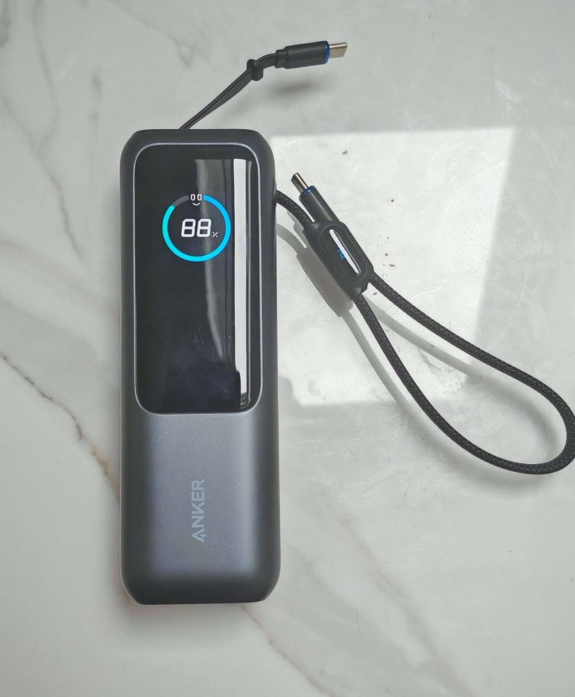

# Best Power Bank 20000mAh 2026

How much wattage is enough depends on the hungriest device you charge from one USB-C port. A bank that matches that device's own charger rating charges it at full speed, and one below it charges a laptop slower, if at all. So 45W covers phones and tablets on chargers rated 45W or less, 65W covers a laptop on a 65W charger, and a laptop that takes more wants the UGREEN. For most people the INIU Power Bank 20000mAh 65W is the one to buy, with 20000mAh at 65W for that laptop.

## The three side by side

| | INIU 65W | INIU 45W | UGREEN 145W |
|---|---|---|---|
| Capacity | 20,000 mAh | 20,000 mAh | 20,000 mAh |
| Watt-hours | Not stated in its listing | Not stated in its listing | 74 Wh, our sum (a) |
| Top output | 65W | 45W USB-C | 145W total, 100W USB-C |
| Outputs | Not stated in its listing | 2: one USB-C (in and out), one USB-A | 3: built-in USB-C cable, USB-C, USB-A |
| Built-in cable | Not stated in its listing | No | Yes |
| Cabin bag | Carry-on only; check the Wh on the pack (b) | Carry-on only; check the Wh on the pack (b) | Carry-on only; under the FAA's 100 Wh limit (a) |

(a) UGREEN lists the bank's voltage as 3.7 but gives no watt-hour figure, so 74 Wh is our sum, 20000mAh x 3.7V / 1000, and UGREEN itself calls the bank "fine to take on planes".

(b) For the INIUs, read the Wh printed on the pack and check it against our [power bank flight rules guide](power-bank-flight-rules-uk.html).

## Top picks

### 1. INIU Power Bank 20000mAh 65W - Best Overall

**SPP Score: 9.2 / 10** - 20000mAh capacity and 65W fast charging. Our all-round pick.

Scorecard: Capability 9.8/10 - Versatility 8.0/10 - Build 8.9/10 - Value 8.9/10 - Fit 9.8/10

Fit for this guide: This guide asks for 20000mAh in one pack, and its 65W also reaches a laptop on a 65W charger.

INIU sells this as its laptop bank, at 65W from 20000mAh.

**Pros**
- ✓ 65W, enough for a laptop on a 65W charger, and sold by INIU as a "Laptop Power Bank"
- ✓ INIU's listing title calls it the "Smallest 20000mAh 65W"

**Cons**
- ✗ Below the UGREEN's 100W USB-C, so a laptop on a charger above 65W tops up slower
- ✗ Its listing states no port layout or watt-hours, so check the label on the pack before you fly

**Who it's for:** Anyone who wants one 20000mAh pack for a phone, a tablet or a laptop on a charger of up to 65W.
**Who it's not for:** Anyone whose laptop takes more than 65W, who should look at the UGREEN.

[Check price](https://www.amazon.co.uk/dp/B0DB89DSHV?linkCode=ll2&tag=souvlakia-21)

---

### 2. INIU Power Bank 20000mAh 45W - Best Budget

**SPP Score: 8.9 / 10** - 20000mAh capacity, 45W USB-C fast charging, USB-C in and out. Our value pick.

Scorecard: Capability 9.4/10 - Versatility 8.0/10 - Build 8.9/10 - Value 8.9/10 - Fit 8.9/10

Fit for this guide: It holds the same 20000mAh on two ports, and its 45W USB-C output is sized for a phone and a tablet.

The INIU Power Bank 20000mAh 45W keeps the full 20000mAh on two ports: one USB-C that both charges your devices and refills the bank, and one USB-A for a second device. If phones and a tablet are what you charge, you give up some wattage here rather than capacity.

**Pros**
- ✓ 45W USB-C, which INIU's listing title calls "Fast Charging"
- ✓ INIU's listing calls it "30% Smaller"

**Cons**
- ✗ Two outputs, one USB-C and one USB-A, against the UGREEN's three
- ✗ At 45W, the lowest top output of the three

**Who it's for:** Phone and tablet users who want the full 20000mAh.
**Who it's not for:** Owners of a laptop on a charger rated above 45W, whom the 65W INIU or the UGREEN suit better.

[Check price](https://www.amazon.co.uk/dp/B0DCZ82MGG?linkCode=ll2&tag=souvlakia-21)

---

### 3. UGREEN Nexode Power Bank 20000mAh 145W - Best Premium

**SPP Score: 8.5 / 10** - 20000mAh capacity, 145W output, built-in USB-C cable and three-port output. Our pick for maximum capability.

Scorecard: Capability 9.8/10 - Versatility 7.1/10 - Build 8.5/10 - Value 8.9/10 - Fit 8.0/10

Fit for this guide: 145W output and a built-in cable go past what a general 20000mAh guide asks, suiting laptop users.

UGREEN says this bank "Powers laptops with up to 100W via USB-C and 145W total across all ports", the highest USB-C figure of the three. One of its three outputs is a built-in USB-C cable, so a lead is always attached, and the remaining outputs take leads of your own.

**Pros**
- ✓ 145W in total, the most of the three picks
- ✓ Built-in USB-C cable means one less lead to carry
- ✓ Three outputs, including the built-in cable, charge several devices at once

**Cons**
- ✗ Its built-in USB-C cable cannot be swapped out if it wears
- ✗ Only two of its three outputs take a lead of your choice

**Who it's for:** Owners of a laptop that charges at up to 100W, who want the lead attached.
**Who it's not for:** Anyone who only charges a phone, which the 45W INIU covers with the same 20000mAh.

[Check price](https://www.amazon.co.uk/dp/B0DSPVP337?linkCode=ll2&tag=souvlakia-21)

---

## Quick verdict

Most people: the **[INIU Power Bank 20000mAh 65W](https://www.amazon.co.uk/dp/B0DB89DSHV?linkCode=ll2&tag=souvlakia-21)**, for 20000mAh at 65W. Phones and a tablet only: the **[INIU Power Bank 20000mAh 45W](https://www.amazon.co.uk/dp/B0DCZ82MGG?linkCode=ll2&tag=souvlakia-21)**, the same capacity on two ports. A laptop on a charger above 65W, or a lead that never gets left behind: the **[UGREEN Nexode Power Bank 20000mAh 145W](https://www.amazon.co.uk/dp/B0DSPVP337?linkCode=ll2&tag=souvlakia-21)**.

## Charging a laptop over USB-C

A laptop charges from one port, so read a bank's single-port figure, not its total; the top output row in the table gives both for the UGREEN, while the INIU 65W's listing does not say how its 65W splits across ports. For scale, Apple lists a "140W USB-C Power Adapter" for the 16-inch MacBook Pro's fastest charge, more than any of the three gives from one port. The lead matters too: a USB-C cable rated 60W stops at 3A, so above 60W you need one rated 100W or 240W, like the [fast-charging USB-C cables we pick](best-usb-c-cable-for-fast-charging.html). If a laptop is the main thing you need to charge, our [power bank for laptops guide](best-power-bank-for-laptops-uk.html) compares that class on its own.

## Want a smaller pack?

A 10000mAh pack holds half the capacity: about two full charges of a 4000mAh phone against about four from 20000mAh, by the sums in our [guide to how many charges you get from a 20000mAh power bank](how-many-charges-from-a-20000mah-power-bank.html). For 10000mAh, our [MagSafe power bank guide](best-magsafe-power-bank-uk.html) has the Anker MagGo and the UGREEN MagFlow (which has a built-in cable), both of which snap onto the back of an iPhone.

## The bank we carry ourselves

The bank we own and fly with is Anker's 25000mAh Travel Essential. Its pair of built-in retractable USB-C cables plus one more USB-C port can charge phone, tablet and laptop together, and daily use and travel have left it without wear. At 25000mAh it isn't one of this page's 20000mAh picks; our [power banks for long flights guide](best-power-bank-for-long-flights.html) covers it in full.

<figure class="owned-photos"><figcaption>Our own Anker 25000mAh unit, photographed at home with both built-in cables out.</figcaption></figure>

## How we chose

With the capacity fixed at 20000mAh, we compared what decides the buy: the USB-C wattage from one port, how many outputs there are and of which kind, and whether a cable is built in. Wattage, port and watt-hour figures come from each maker's listing title or product page, with the table's watt-hours worked out only from a voltage the maker states, and the flight rules from the CAA and FAA pages listed under Sources.

## FAQ

**Q: Can I take a 20000mAh power bank on a flight?**
A: Yes, in your hand luggage: at about 74Wh (20000mAh x 3.7V / 1000), it sits under the 100Wh line. The UK CAA says power banks "must only be carried as carry-on baggage", and on US flights the FAA says spare lithium batteries, power banks included, "must be carried in carry-on baggage only", with each limited to "a rating of 100 watt hours (Wh) per battery" unless your airline approves up to two larger spares of up to 160 Wh. Airlines can set stricter limits, so check yours; our [power bank flight rules guide](power-bank-flight-rules-uk.html) covers using a bank on board, and our [power banks for long flights guide](best-power-bank-for-long-flights.html) picks for cabin use.

**Q: How long does a 20000mAh power bank take to recharge?**
A: Anker's charging guide lists "8-10 hours" on a standard charger and "~4-6 hours" on a fast one for a 20,000mAh bank, not for the three banks here. Your wait is set by the bank's input rating and the charger you refill it from, so check the input watts on the listing and use a charger that can supply them; our [guide to how long a power bank takes to charge](how-long-to-charge-a-power-bank.html) shows how to speed it up.

---

*Affiliate disclosure: This page contains affiliate links. As an Amazon Associate we earn from qualifying purchases, at no extra cost to you. See our [disclosure page](https://simpleproductpicks.com/disclosure.html) for details.*
